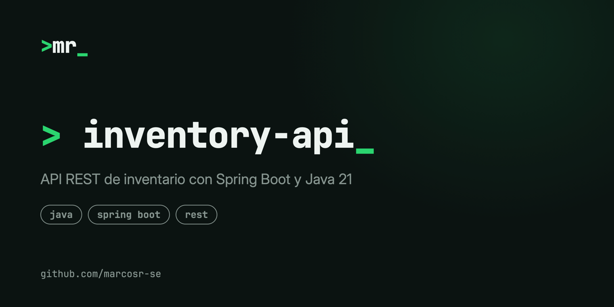

# Product Inventory API



REST API for managing a product inventory, built with **Spring Boot** and **Java 21**, with a simple HTML/JavaScript front end (UI in Spanish).

You can list, create and delete products, and update their stock with incoming and outgoing movements. A small dashboard shows the number of products, total units and total inventory value.

## Endpoints

| Method | Path | Description |
|---|---|---|
| `GET` | `/api/productos` | List all products |
| `POST` | `/api/productos` | Create a product (JSON body: `nombre`, `stock`, `precio`) |
| `PUT` | `/api/productos/{id}/stock?cantidad=N&operacion=entrada\|salida` | Add stock (`entrada`) or remove it (`salida`) |
| `DELETE` | `/api/productos/{id}` | Delete a product |

## Run it locally

Requires Java 21.

```bash
./mvnw spring-boot:run
```

Then open http://localhost:8080.

## Notes

- Data is kept in memory (a `HashMap` in the repository), so it resets every time the app restarts.
- I wrote the Java/Spring code myself, with AI as a helper; the front end was mostly AI-generated.
- Next steps I'd like to add: a real database (JPA + PostgreSQL), input validation, proper HTTP error responses and tests.
